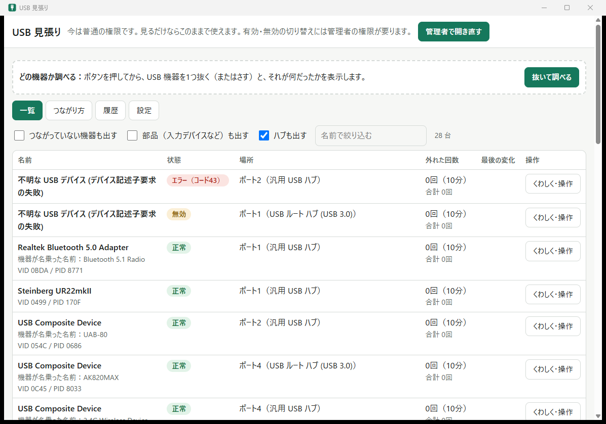
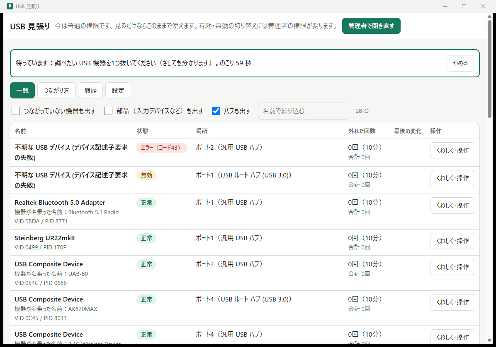
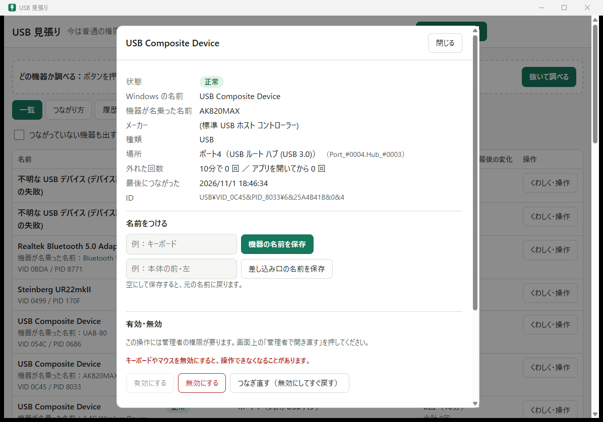
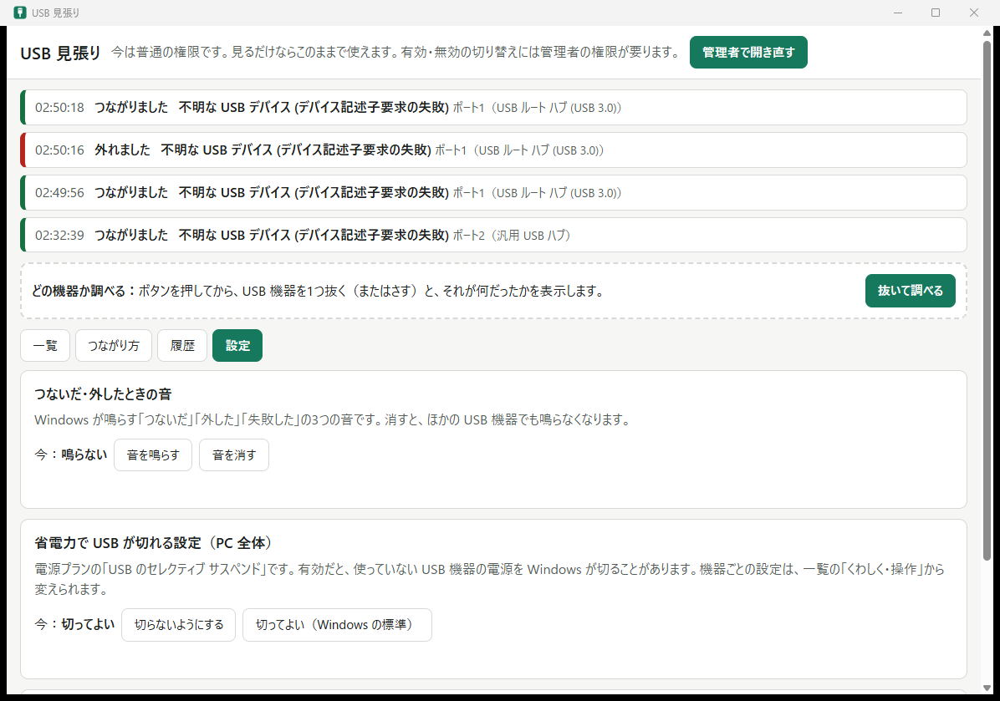

# USB 見張り

USB 機器の一覧を出して、**つないだ・外れた**をその場で知らせる Windows 用のアプリです。
「さっきから USB が外れる音がする」ときに、どの機器が原因かを探すために作りました。



## できること

| 機能                   | 内容                                                                                                                                              |
| ---------------------- | ------------------------------------------------------------------------------------------------------------------------------------------------- |
| 一覧                   | つながっている USB 機器と、その状態（正常・エラー・無効・つながっていない）・場所を表示します。機器が自分で名乗った名前（例：AK820MAX）も出します |
| つないだ・外れたの表示 | 変化があると、画面の上に時刻つきで出します。外れた機器は消さずに残します。1秒もしないうちに戻った機器も「外れてすぐ戻りました」と出します                                                                          |
| 外れた回数             | 10分で3回以上外れた機器は、赤い印と「くり返し外れています」を出して、一覧の一番上に並べます                                                       |
| 抜いて当てる           | ボタンを押してから機器を1つ抜く（さす）と、それが何だったかを表示します                                                                           |
| 名前をつける           | 機器と差し込み口に、自分で分かる名前をつけられます（例：「キーボード」「本体の前・左」）                                                          |
| 有効・無効             | 機器を無効にしたり、有効に戻したりします。無効にしてすぐ戻す「つなぎ直す」もあります                                                              |
| 省電力の設定           | 「省電力のために Windows が USB の電源を切ってよいか」を、機器ごとと PC 全体で変えられます                                                        |
| 音のオン・オフ         | Windows の「つないだ・外した・失敗した」の音を消したり、元に戻したりします                                                                        |
| 履歴                   | いつ何がつながって、いつ外れたかをファイルに残します                                                                                              |

## 画面

### どの機器か調べる（抜いて当てる）

「抜いて調べる」を押すと、60秒待ちます。その間に機器を1つ抜くと、名前と場所が出ます。そのまま名前をつけることもできます。



### つながり方

コントローラー（PC本体の USB の口のまとまり）→ ハブ → 機器 の順に並べます。ハブごと調子が悪いときに見つけやすくなります。


### くわしく・操作

一覧の「くわしく・操作」を押すと開きます。名前つけ、有効・無効、省電力の設定をここで変えます。
キーボードやマウス、ハブを無効にしようとすると、注意が出ます。



### 設定

音のオン・オフと、PC 全体の省電力の設定です。



## 使い方

1. `usb-watch.exe` を開きます
2. 見るだけなら、このまま使えます
3. 有効・無効や省電力の設定を変えるときは、上の「管理者で開き直す」を押します（Windows の確認画面が出ます）

### 音がうるさいとき

1. 「設定」タブで「音を消す」を押す（まず静かにする）
2. 「抜いて調べる」を押して、怪しい機器を1つずつ抜いて、原因の機器を探す
3. 見つかったら、ケーブルや差し込み口を変える。直ったら「音を鳴らす」で戻す

エラーの「コード43」は、機器が Windows に名前を伝える前に失敗した、という意味です。よくある原因は、ケーブル・接触不良・機器の故障・電力不足です。このときは本当の機器名が分からないので、場所（どのポートか）で探します。

## 保存するもの

`%APPDATA%\usb-watch` に保存します。「設定」タブの「保存先のフォルダーを開く」で開けます。

| ファイル            | 中身                                                   |
| ------------------- | ------------------------------------------------------ |
| `names.json`        | 自分でつけた名前（機器と差し込み口）                   |
| `history.jsonl`     | つないだ・外れたの記録（1行に1回分）                   |
| `sound_backup.json` | 音を消す前の設定（「音を鳴らす」で戻すときに使います） |

## 作り方（ビルド）

Rust と Tauri 2 で作っています。画面は `ui/index.html` の1枚だけです（Node やバンドラーは使いません）。

```bat
cd src-tauri
cargo build --release -j 4
```

できた exe は `src-tauri\target\release\usb-watch.exe` です。
試験用のビルド（`cargo build`）だと、黒い窓も一緒に開きます。

### ファイルの役割

| ファイル                   | 役割                                                                                                                          |
| -------------------------- | ----------------------------------------------------------------------------------------------------------------------------- |
| `src-tauri/src/devices.rs` | 機器の一覧と、有効・無効の切り替え（SetupAPI / CfgMgr32）                                                                     |
| `src-tauri/src/watch.rs`   | つないだ・外れたの見張り。Windows の知らせを合図に一覧を取り直して比べます。知らせが来ない機器のために 1.5 秒ごとにも比べます |
| `src-tauri/src/power.rs`   | 省電力の設定（機器ごとは WMI の `MSPower_DeviceEnable`、全体は `powercfg`）                                                   |
| `src-tauri/src/sound.rs`   | 音の設定（`HKCU\AppEvents\Schemes`）                                                                                          |
| `src-tauri/src/store.rs`   | 名前と履歴の保存                                                                                                              |
| `src-tauri/src/main.rs`    | 画面から呼ぶ機能の入り口                                                                                                      |
| `ui/index.html`            | 画面                                                                                                                          |

## 注意

- 有効・無効は、デバイスマネージャーで切り替えるのと同じです。キーボードを無効にすると打てなくなるので、戻すときはマウスで「有効にする」を押してください
- 機器を無効にしても、機器そのものが抜き差しをくり返すことがあります（ケーブルや機器が原因のとき）。そのときは音を消してから、原因の機器を探してください
