# USB 見張り

USB 機器の一覧を出して、**つないだ・外れた**をその場で知らせる Windows 用のアプリです。
「さっきから USB が外れる音がする」ときに、どの機器が原因かを探すために作りました。


## ダウンロード

[Releases](https://github.com/hhurt21/usb-preview/releases) から `usb-watch.exe` をダウンロードして開くだけです。インストールは要りません。

`usb-watch.exe` は1つのファイルだけで動きます。画面（HTML・絵）は exe の中に入っていて、横に置くファイルはありません。名前と履歴は使っているうちに `%APPDATA%\usb-watch` に作られます。

- Windows 10 / 11 用です。画面の表示に Microsoft Edge WebView2 を使います（Windows 11 には最初から入っています）
- 署名していない exe なので、初めて開くときに SmartScreen が出ることがあります。「詳細情報」→「実行」で開けます

## できること

| 機能                     | 内容                                                                                                        | 管理者の権限 |
| ------------------------ | ----------------------------------------------------------------------------------------------------------- | ------------ |
| 一覧                     | USB 機器の名前・状態・場所・外れた回数を表示します。機器が自分で名乗った名前（例：AK820MAX）も出します      | 要らない     |
| 絞り込み                 | つながっていない機器、部品（入力デバイスなど）、ハブを出すかどうかと、名前で絞り込めます                    | 要らない     |
| つないだ・外れたの表示   | 変化があると、画面の上に時刻つきで出します。1秒もしないうちに戻った機器も「外れてすぐ戻りました」と出します | 要らない     |
| くり返し外れる機器の印   | 10分で3回以上外れた機器は、赤い印と「くり返し外れています」を出して、一覧の一番上に並べます                 | 要らない     |
| 抜いて当てる             | ボタンを押してから機器を1つ抜く（さす）と、それが何だったかを表示します                                     | 要らない     |
| つながり方               | コントローラー → ハブ → 機器 の順に、木の形で並べます                                                       | 要らない     |
| 全体図 | USB だけでなく、画面・音・Bluetooth・ネットワーク・ディスク・入力機器など、PC につながっている全部の機器を、この PC を真ん中にした図で見せます | 要らない |
| PC のスペック | OS・CPU・メモリ（枚数・速さ）・マザーボード・BIOS・GPU（ビデオメモリ・ドライバー）・ディスク（空き容量）・ネットワーク・画面・今使っている音の機器を1画面にまとめ、文字でコピーできます | 要らない |
| SSD の書き込み | 今のディスクへの書き込みの速さ（2秒ごと）、Chrome・Edge のキャッシュを小さくするボタン、SSD を長持ちさせる説明 | 要らない |
| 名前をつける             | 機器と差し込み口に、自分で分かる名前をつけられます（例：「キーボード」「本体の前・左」）                    | 要らない     |
| 履歴                     | いつ何がつながって、いつ外れたかをファイルに残して、新しい順に表示します                                    | 要らない     |
| 音のオン・オフ           | Windows の「つないだ・外した・失敗した」の音を消したり、元に戻したりします                                  | 要らない     |
| 省電力の設定（PC 全体）  | 電源プランの「USB のセレクティブ サスペンド」を変えます                                                     | 要らない     |
| 有効・無効・つなぎ直す   | 機器を無効にしたり、有効に戻したりします。無効にしてすぐ戻す「つなぎ直す」もあります                        | **要る**     |
| 省電力の設定（機器ごと） | 「省電力のために Windows がこの機器の電源を切ってよいか」を変えます                                         | **要る**     |

## 使い方

1. `usb-watch.exe` を開きます。見るだけなら、このまま使えます
2. 有効・無効や機器ごとの省電力を変えるときは、上の「管理者で開き直す」を押します。Windows の確認画面で「はい」を押すと、題名が「USB 見張り（管理者）」の窓に入れ替わります

USB 見張りは1つしか開きません。もう開いているときに exe を開くと、開いている窓が前に出てきます。

### 音がうるさいとき

1. 「設定」タブで「音を消す」を押す（まず静かにする）
2. 「抜いて調べる」を押して、怪しい機器を1つずつ抜き、原因の機器を探す
3. 見つかったら、ケーブルや差し込み口を変える。直ったら「音を鳴らす」で元に戻す

エラーの「コード43」は、機器が Windows に名前を伝える前に失敗した、という意味です。よくある原因は、ケーブル・接触不良・機器の故障・電力不足です。このときは本当の機器名が分からないので、場所（どのポートか）で探します。

## 画面

### 一覧と絞り込み

最初の画面です。上に、つながった・外れたの記録が新しい順に4つ並びます。

| 欄         | 内容                                                                                                             |
| ---------- | ---------------------------------------------------------------------------------------------------------------- |
| 名前       | 自分でつけた名前 → Windows の名前 の順に出します。下の小さな文字は、元の名前・機器が名乗った名前・VID / PID です |
| 状態       | 正常（緑）・エラー（赤、コードつき）・無効（黄）・つながっていない（灰）                                         |
| 場所       | 「ポート番号（つながっている先）」。差し込み口に名前をつけると、その名前を出します                               |
| 外れた回数 | 直近10分の回数と、アプリを開いてからの合計                                                                       |
| 最後の変化 | アプリを開いてから最後につながった・外れた時刻                                                                   |

チェックと文字で絞り込めます。下の画像は「部品も出す」にして「AK820」で絞り込んだところです。キーボード本体（USB Composite Device）と、その部品の入力デバイスが並んでいます。

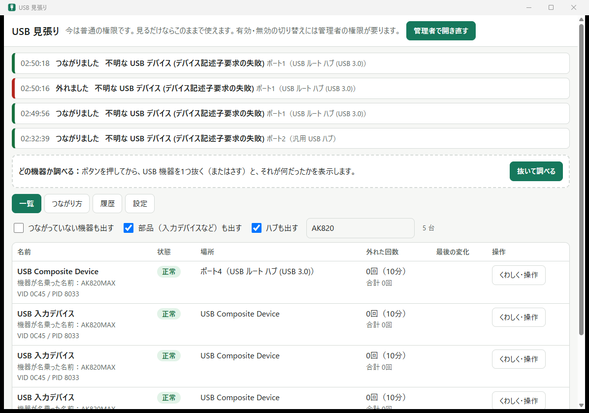

### 全体図

USB だけでなく、PC につながっている全部の機器を1枚の図にします。真ん中が「この PC」（CPU・スレッド数・メモリ・GPU）で、周りに種類ごとの箱を並べて点線でつなぎます。機器の絵は種類ごとに描いた SVG です。

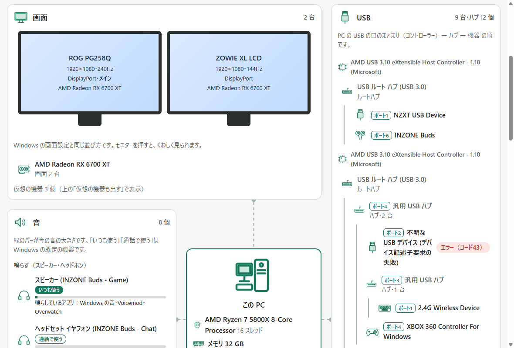

| 箱 | 出す物 |
| --- | --- |
| 画面 | モニターを Windows の画面設定と同じ並び方で描きます。名前・解像度・リフレッシュレート・つなぎ方（HDMI / DisplayPort など）・メインかどうか・つながっている GPU を出します |
| USB | コントローラー → ハブ → 機器 の木の形で、どのハブの何番の口に何がつながっているかを出します。機器の絵は中身（キーボード・ゲームパッド・音の機器・Bluetooth など）から選びます。機器がつながっていないハブは省きます |
| 音 | 鳴らす側（スピーカー・ヘッドホン）と録る側（マイク）。Windows の既定の機器に「いつも使う」「通話で使う」の印をつけ、今の音の大きさをバーで、鳴らしている（録っている）アプリの名前も出します |
| 入力 | キーボード・マウス・ゲームパッド。「HID キーボード デバイス」のような部品は、もとの機器（例：AK820MAX）にまとめます |
| Bluetooth | アダプターと、ペアリングした機器 |
| ネットワーク | つながっているかと速さ |
| 保存 | ディスクの容量とつなぎ方（NVMe / USB など） |
| その他 | シリアル（COM）・カメラ・プリンターなど |
| Windows の中の部品 | マザーボードやドライバーの部品など。種類ごとにたたんであります |

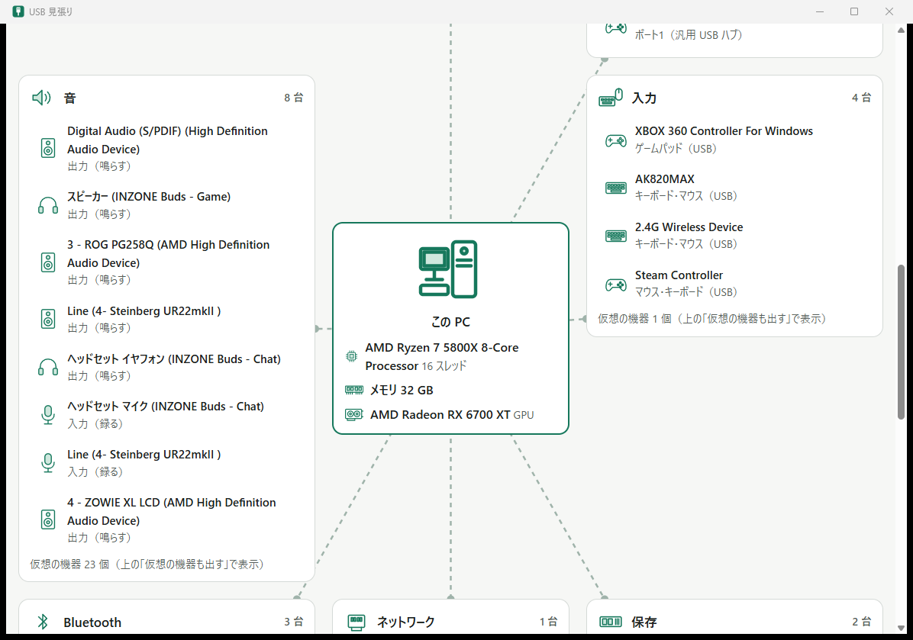

音の箱と USB の木です。下の画像では、いつも使うスピーカーで Overwatch・Voicemod が鳴っていて、通話用のヘッドセットは Discord が使っています。USB の木では、ハブの先のハブの、何番の口に何がつながっているかが分かります。

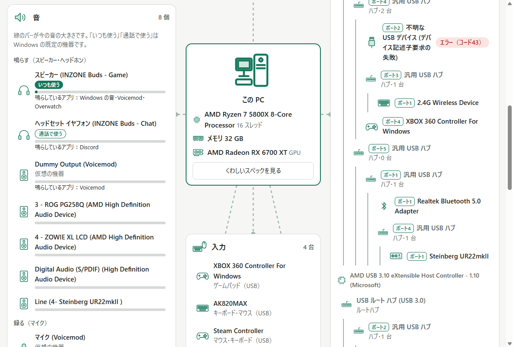

- **仮想の機器**（Voicemeeter・VMware・Parsec など、アプリや Windows が作った機器）は、最初は数だけ出します。「仮想の機器も出す」にすると並びます。機器の親をたどって、本物の部品（PCI・ACPI）に着く前に Windows が作った機器（ROOT・SWD）に着いたら、仮想とみなしています
- 既定の機器と、アプリが使っている音の機器は、仮想の機器（Voicemod など）でも必ず出します
- 音の大きさのバーは、全体図を見ている間だけ 0.5 秒ごとに読みます
- 「この PC」の箱の「くわしいスペックを見る」で、PC のスペックタブに移ります
- 「名前で探す」に文字を入れると、全部の箱をまとめて絞り込みます
- 機器を押すと「くわしく・操作」が開きます。GPU・ディスク・ネットワークなど、無効にすると PC が正しく動かなくなる物には、強い注意が出ます
- 機器がつながったり外れたりすると、自動で読み直します。解像度を変えたときなどは「読み直す」を押してください

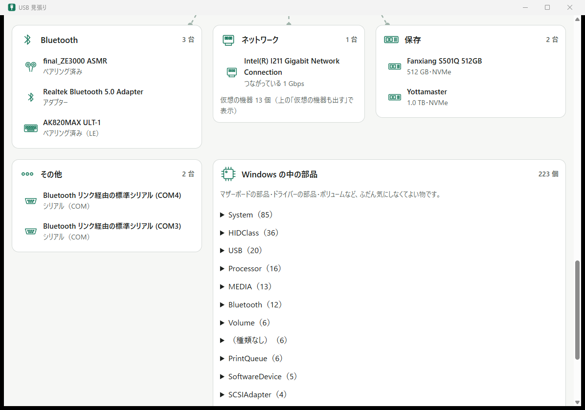

### PC のスペック

OS・CPU・メモリ・マザーボード・BIOS・GPU・ディスク・ネットワーク・画面・今使っている音の機器を、1画面にまとめます。

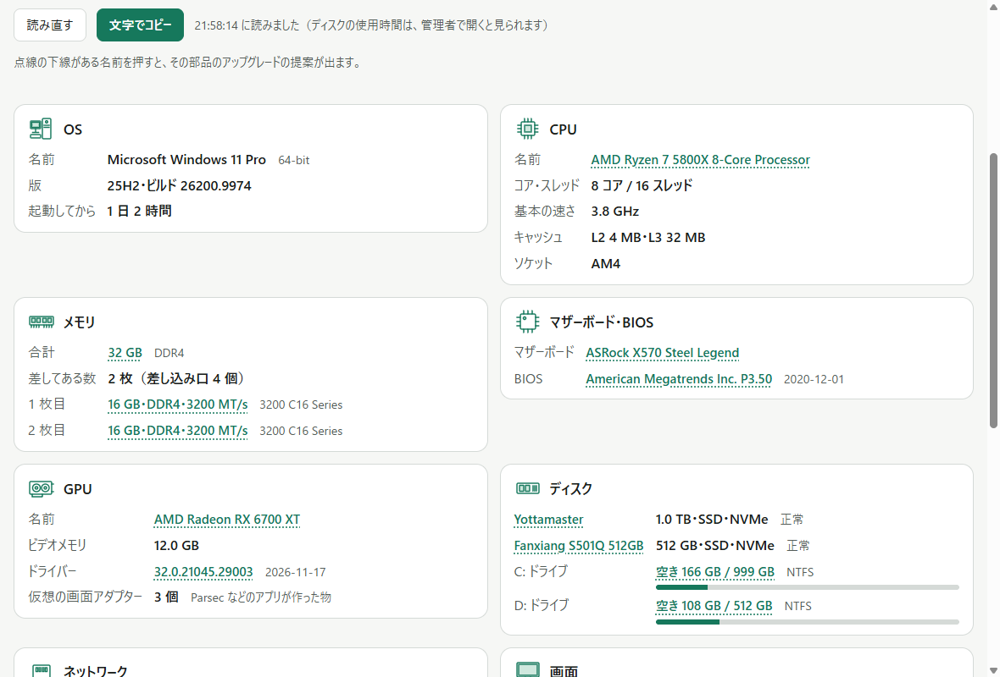

- **メモリ**：差してある枚数と差し込み口の数、1枚ずつの容量・種類（DDR4 / DDR5 など）・速さ
- **GPU**：ビデオメモリはレジストリの正しい値を使います（Windows の管理情報だと 4GB で頭打ちになるため）。アプリが作った仮想の画面アダプターは数だけ出します
- **ディスク**：ドライブごとの空きをバーで出し、空きが1割を切ると赤にします
- **使った時間・年数**：
  - モニター：画面がついていた合計時間（モニターと PC が話す仕組み DDC/CI で読みます。対応していないモニターは「記録なし」）
  - SSD：電源が入っていた合計時間・電源を入れた回数・書き込んだ量・消耗度・温度（NVMe SSD 自身の健康記録を読みます。管理者で開いたときだけ）
  - CPU・GPU の発売からの年数（目安）、今の Windows を入れてから、BIOS が作られてから
  - 時間は「1年10か月（16,797 時間）」のように、年と月でも出します
- **アップグレードの提案**：まずスペックを見られるように、提案は最初は出しません。点線の下線がある部品の名前（CPU・ディスク・モニターなど）を押すと、その部品の箱の中に「すぐやるとよい」「余裕があれば」「今のままで十分」に分けて、理由と一緒に出ます。見ているのは、ディスクの空き・SSD の消耗と警告・メモリの量と速さ（XMP / EXPO が切れていないか）・CPU（AM4 なら 5700X3D / 5800X3D など）・GPU（画面の解像度とリフレッシュレートに足りるか）・BIOS とドライバーの古さ・モニターの使用時間・USB の不調・LAN の速さです。製品名はこのアプリを作った時点（2026年）の目安です。「文字でコピー」では、スペックのあとに提案の一覧が付きます

  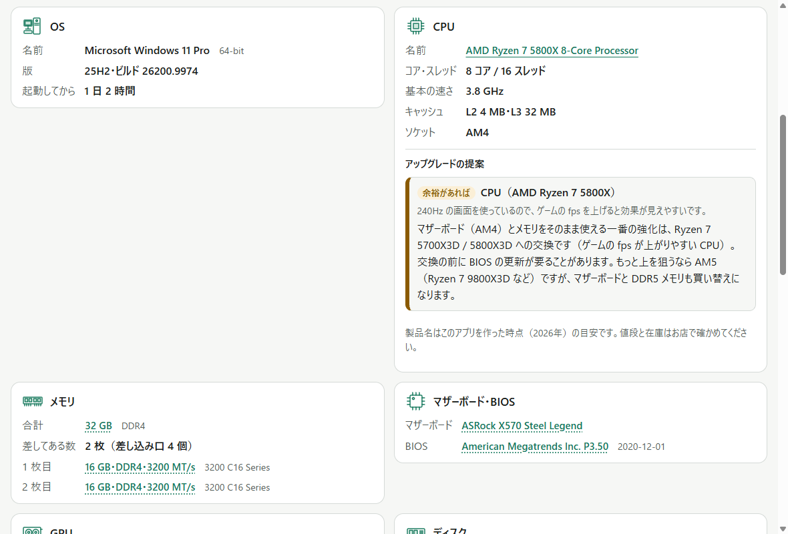
- **文字でコピー**：全部を文字にしてコピーします。Discord などに貼って、PC の相談に使えます
- PC の名前・ユーザー名・シリアル番号・MAC アドレス・IP アドレスなど、人や機械を特定できる情報は集めません（画面にもコピーにも出ません）
### SSD の書き込み

SSD は書き込める量に上限があるので、何がどれだけ書いているかを見て、無駄な書き込みを減らすためのページです。「PC のスペック」の「ストレージの寿命」の箱からも移れます。

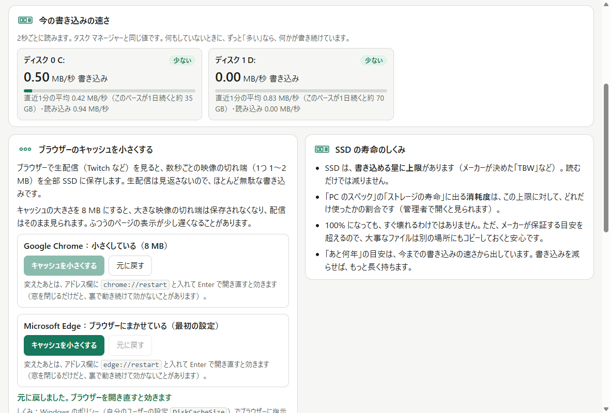

- **今の書き込みの速さ**：ディスクごとに 2秒ごとに出します（タスク マネージャーと同じ値）。直近1分の平均と、「このペースが1日続くと何 GB か」も出します
- **ブラウザーのキャッシュを小さくする**：ブラウザーで生配信を見ると、映像の切れ端（1つ 1〜2 MB）を全部 SSD に保存します。ボタンを押すと、ディスク キャッシュを 8 MB にして、大きな切れ端を保存させないようにします。「入っているブラウザーを全部小さくする」ボタンと、ブラウザーごとの「元に戻す」があります。管理者の権限は要りません
  - ポリシー（どこから開いても効く）：Chrome・Edge・Brave・Vivaldi・SRWare Iron（Chromium と同じ場所）・Chromium・Yandex
  - 設定ファイル user.js（プロファイルごと）：Firefox・Floorp・Waterfox・LibreWolf・Zen・Pale Moon。「元に戻す」は Firefox の最初の値を書き込みます
  - ショートカットの `--disk-cache-size`（ほかのアプリのリンクから開いたときは効かない）：Opera・Opera GX・Thorium・Supermium
  - 「今すぐ開き直す」ボタン：設定を変えたあとにブラウザーを終わらせて開き直します。**開いていたタブは戻らないことがあります**（いくつかの方法を試しましたが、外から開き直すとタブを戻せませんでした）。タブを残したいときは、ブラウザーのアドレス欄に `chrome://restart` などを入れて自分で開き直してください。このアプリを管理者で開いているときは、閉じるだけにします
  - Chrome・Edge・Brave・Vivaldi・Iron・Firefox は、`tools/test_browser_cache.py` で本当に効くことを確かめました（試験用のサーバーで配った 3 MB のファイルが、設定するとキャッシュに入らなくなる）。ほかは画面に「この PC では未確認」と出ます
- **説明**：SSD の寿命のしくみ、書き込みが多くなるよくある原因（生配信・記録する拡張機能・ゲームの更新・録画・ドライバーの不具合）、リソース モニターで自分で調べる方法、この PC で調べて直した例（2026年11月22日：C: への書き込みが 2.69 → 1.12 MB/秒）

PC のスペックには **ストレージの寿命** の箱もあります。ディスクごとに、健康状態（良好・注意・危険）・寿命の残りのバー・今までと同じ使い方ならあと何年か・1日あたりの書き込み量を出します（管理者で開いたとき。普通の権限なら箱の中に「管理者で開き直す」ボタンが出ます）。


### 抜いて当てる

「抜いて調べる」を押すと、60秒待ちます。


その間に機器を1つ抜く（さす）と、名前と場所が出ます。「この機器に名前をつける」を押すと、そのまま名前をつけられます。
下の画像は、例の不明な機器が外れたのを当てたところです。そのあと戻ってきたので、一覧では「1回」「つながった 03:00:03」になっています。

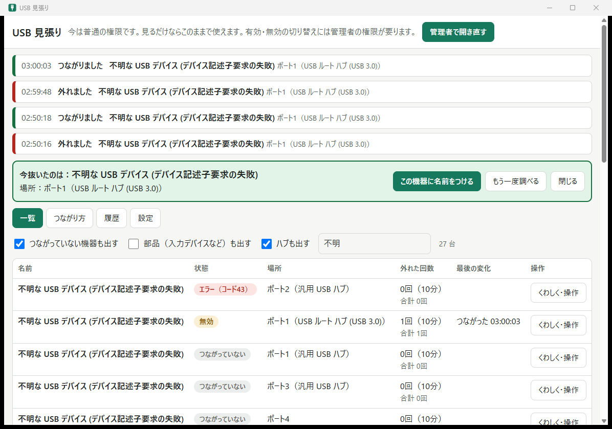

### つながり方

コントローラー（PC本体の USB の口のまとまり）→ ハブ → 機器 の順に並べます。ハブごと調子が悪いときに見つけやすくなります。くり返し外れている機器は赤い枠で囲みます。

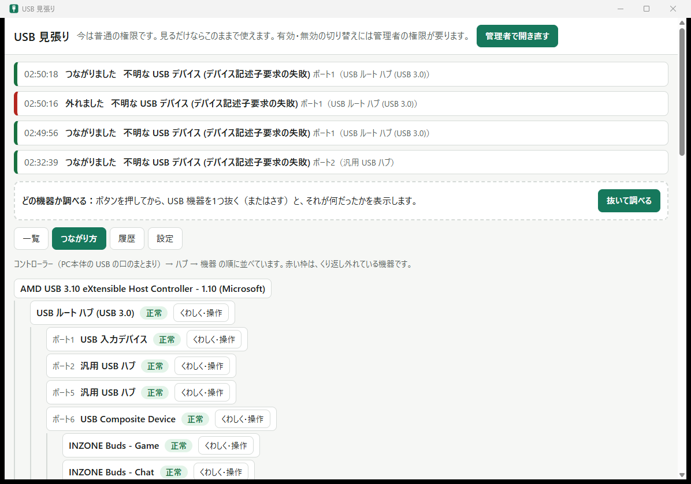

### くわしく・操作

一覧かつながり方の「くわしく・操作」を押すと開きます。状態・名前・メーカー・場所・外れた回数・ID が並び、その下で名前をつけます。


下に進むと、有効・無効と省電力の設定があります。

- キーボードやマウス（部品に入力デバイスがある機器も含む）を無効にしようとすると、赤い注意と確認が出ます
- ハブを無効にしようとすると、「その先の機器も全部使えなくなります」と出ます
- キーボードのような複合機器は、本体ではなく部品のほうに省電力の設定があります。その場合は「部品4個の設定」のように出して、ボタン1つで部品の分をまとめて変えます
- 操作の結果（「無効にしました」など）は、窓を閉じるまで残ります

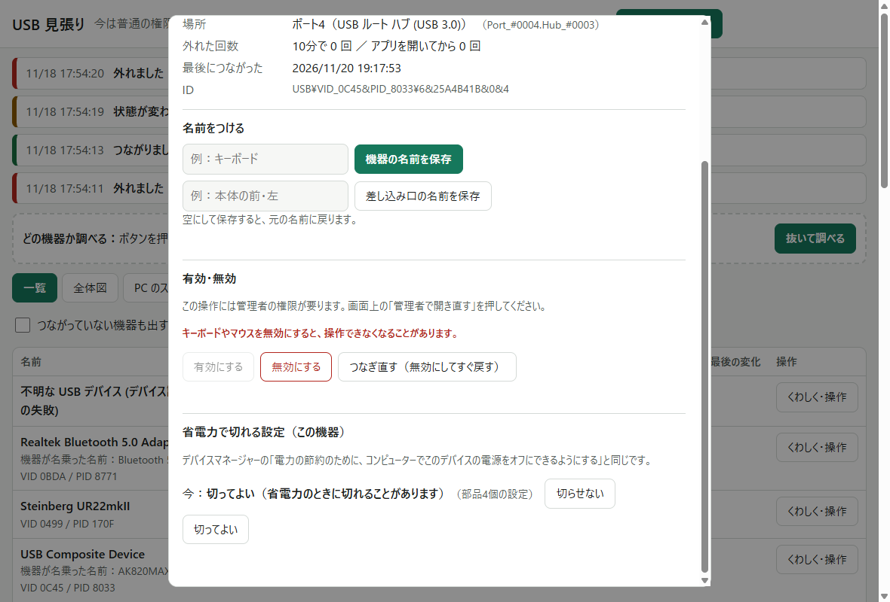

### 履歴

つながった・外れた・外れてすぐ戻った・状態が変わった、を新しい順に最大500件表示します。

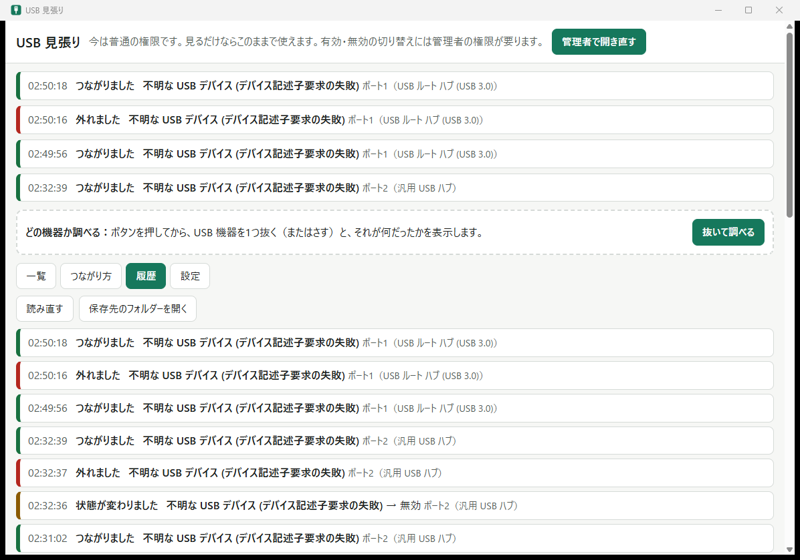

### 設定

音のオン・オフと、PC 全体の省電力の設定です。今の状態を「今：」のあとに出します。


## 保存するもの

`%APPDATA%\usb-watch` に保存します。「設定」タブか「履歴」タブの「保存先のフォルダーを開く」で開けます。

| ファイル            | 中身                                                   |
| ------------------- | ------------------------------------------------------ |
| `names.json`        | 自分でつけた名前（機器と差し込み口）                   |
| `history.jsonl`     | つないだ・外れたの記録（1行に1回分）                   |
| `sound_backup.json` | 音を消す前の設定（「音を鳴らす」で戻すときに使います） |

画面を描く部品（WebView2）の作業フォルダーは `%LOCALAPPDATA%\usb-watch` です。普通の権限・管理者・試験用で別のフォルダーを使います（同じフォルダーを同時に使うと開けなくなるため）。

## 作り方（ビルド）

Rust と Tauri 2 で作っています。画面は `ui/index.html` の1枚だけです（Node やバンドラーは使いません）。

```bat
cd src-tauri
cargo test -j 4
cargo build --release -j 4
```

できた exe は `src-tauri\target\release\usb-watch.exe` です。

試験用のビルド（`cargo build`）は次の点が違います。配る exe には入りません。

- 黒い窓（コンソール）も一緒に開きます
- 画面を外から操作する口（`127.0.0.1:9333`、Chrome DevTools Protocol）を開きます

### ファイルの役割

| ファイル                   | 役割                                                                        |
| -------------------------- | --------------------------------------------------------------------------- |
| `src-tauri/src/devices.rs` | 機器の一覧と、有効・無効の切り替え（SetupAPI / CfgMgr32）                   |
| `src-tauri/src/watch.rs`   | つないだ・外れたの見張り（下を参照）。比べ方のテストもここにあります        |
| `src-tauri/src/power.rs`   | 省電力の設定（機器ごとは WMI の `MSPower_DeviceEnable`、全体は `powercfg`） |
| `src-tauri/src/sound.rs`   | 音の設定（`HKCU\AppEvents\Schemes`）                                        |
| `src-tauri/src/display.rs` | 画面の情報（QueryDisplayConfig：名前・解像度・Hz・つなぎ方・位置・GPU） |
| `src-tauri/src/overview.rs` | 全体図の情報（CPU・メモリ・全部の機器、ディスクとネットワークの詳細） |
| `src-tauri/src/audio.rs` | 今使っている音の機器（既定の機器・音の大きさ・鳴らしているアプリ。Windows の音の仕組み Core Audio に直接聞く） |
| `src-tauri/src/diskrate.rs` | 今のディスクへの書き込みの速さ（パフォーマンス カウンター） |
| `src-tauri/src/browser.rs` | Chrome・Edge のディスク キャッシュの大きさ（ポリシー） |
| `src-tauri/src/smart.rs` | NVMe SSD の健康記録（電源が入っていた時間・消耗度など）を直接読む。読むだけ |
| `src-tauri/src/spec.rs` | PC のスペック（Windows の管理情報 CIM とレジストリ） |
| `src-tauri/src/store.rs`   | 名前と履歴の保存                                                            |
| `src-tauri/src/main.rs`    | 窓を作る・1つだけ開く・管理者で開き直す・画面から呼ぶ機能の入り口           |
| `ui/map.js` | 全体図タブ（仕分け・図・線） |
| `ui/ssd.js` | SSD の書き込みタブ |
| `ui/spec.js` | PC のスペックタブ |
| `ui/icons.js` | 機器の絵（SVG） |
| `tools/` | 試験用の道具（画面の操作 `cdp.mjs`、窓の撮影 `shot.py`、明るい/暗い画面と幅を変えて撮る `cdp_shot.mjs`、置換スクリプト） |
| `ui/index.html`            | 画面                                                                        |

### 見張りの仕組み

1. Windows に「機器が変わったら知らせて」と頼んでおきます（`CM_Register_Notification`）
2. 知らせが来たら 0.15 秒待ってまとめ、USB 機器の一覧を取り直して、前の一覧と比べます。知らせが来ない機器のために、1.5 秒ごとにも比べます
3. 1台を抜くと部品もまとめて消えるので、親が同じ組に入っていない機器（実際に抜いた機器）だけを出して、部品の数を添えます
4. 外れて1秒もしないうちに戻った機器は、一覧を比べても前後とも「ある」に見えます。なので、知らせに入っている「外れた機器の ID」を使って「外れてすぐ戻りました」として数えます

## 注意

- 有効・無効は、デバイスマネージャーで切り替えるのと同じです。キーボードを無効にすると打てなくなるので、戻すときはマウスで「有効にする」を押してください
- 機器を無効にしても、機器そのものが抜き差しをくり返すことがあります（ケーブルや機器が原因のとき）。そのときは音を消してから、原因の機器を探してください
